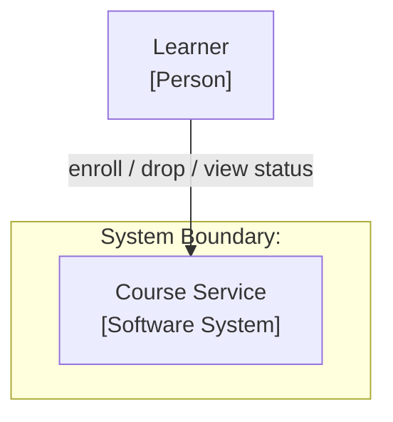
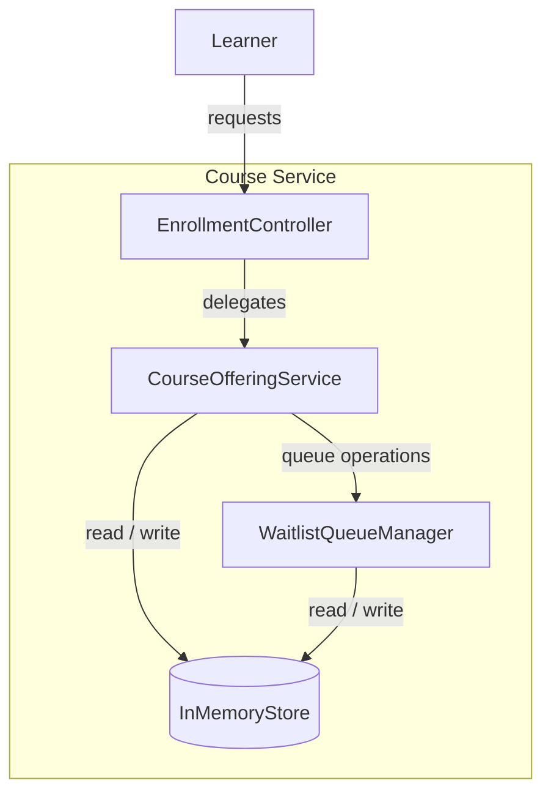

# C4 Architecture: <System Name>

## 1. Context View (C4 Level 1)

## 2. Container / Component View (C4 Level 2/3)

### Component Responsibilities

| Component | Responsibility | Requirements |
|-----------|----------------|--------------|
| EnrollmentController | <responsibility> | REQ-FUN-XXX |
| CourseOfferingService | <responsibility> | REQ-FUN-XXX |
| WaitlistQueueManager | <responsibility> | REQ-FUN-XXX |
| InMemoryStore | <responsibility> | REQ-NFR-XXX |

### Invariants
- <invariant>

## 3. Technology Stack

Decision record: [ADR 0002](../adr/0002-technology-stack-selection.md)

| Layer / Component | Technology | Version | Rationale |
|-------------------|------------|---------|-----------|
| Language | <language> | <version> | <why> |
| EnrollmentController | <framework construct> | <version> | <why> |
| CourseOfferingService | <language construct> | <version> | <why> |
| WaitlistQueueManager | <language construct> | <version> | <why> |
| InMemoryStore | <collection / concurrency primitive> | <version> | <why> |
| Testing | <framework> | <version> | <why> |
| Build / packaging | <tool> | <version> | <why> |
