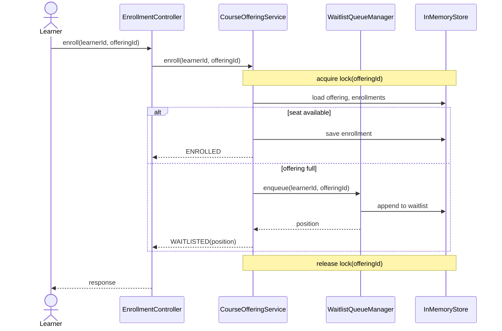
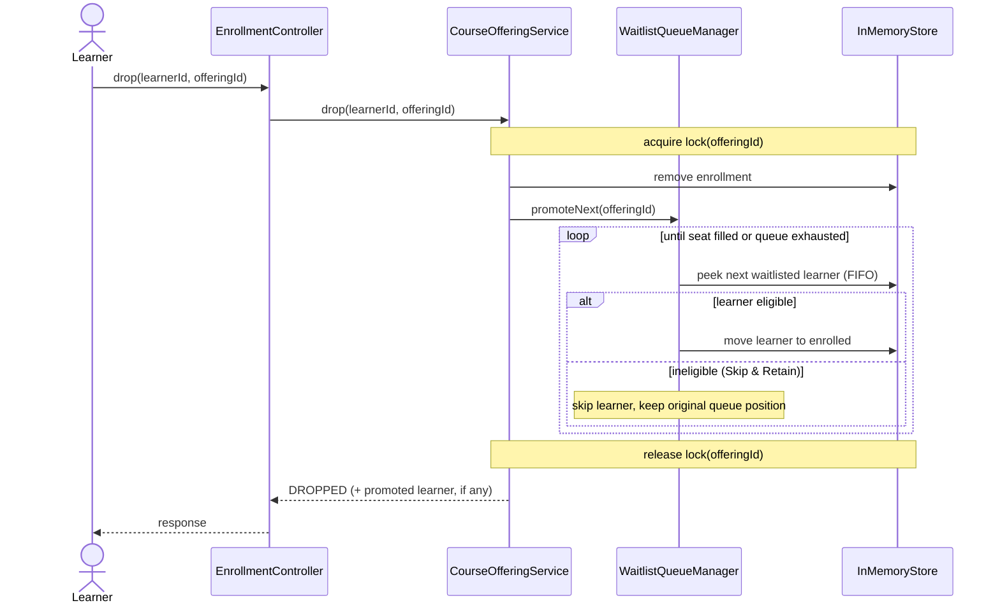
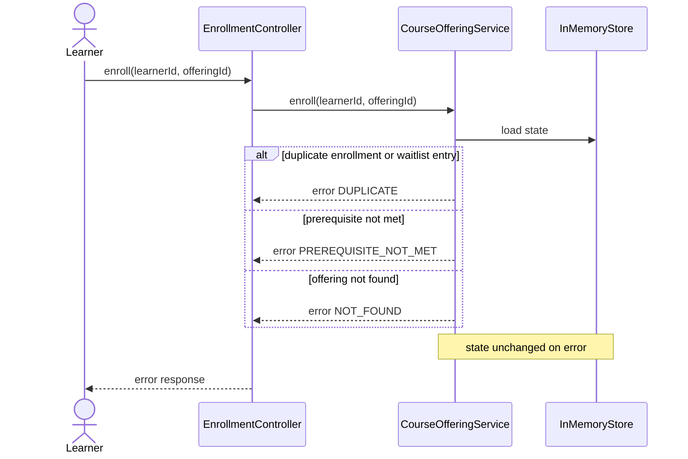

# Sequence Flows: <System Name>

## 1. Successful Enrollment & Full-Capacity Waitlist Redirect
Covers: REQ-FUN-XXX

## 2. Learner Drop Triggering FIFO Waitlist Promotion
Covers: REQ-FUN-XXX

## 3. Duplicate Request & Error Guardrails
Covers: REQ-FUN-XXX

