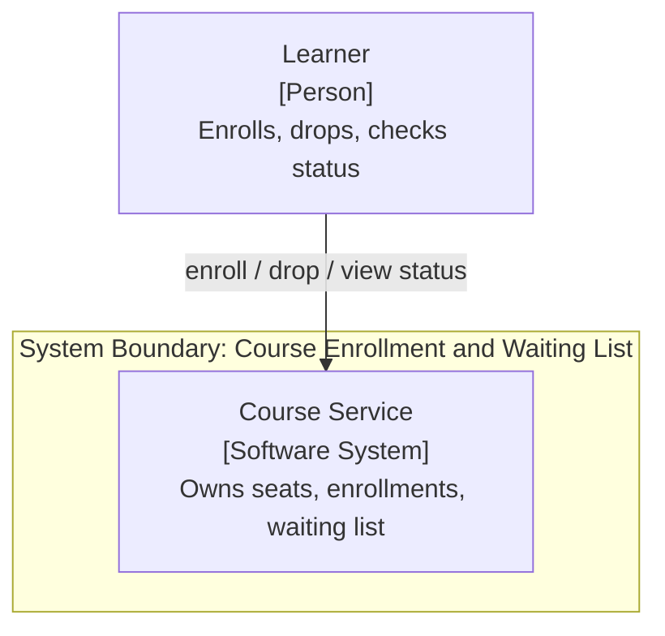
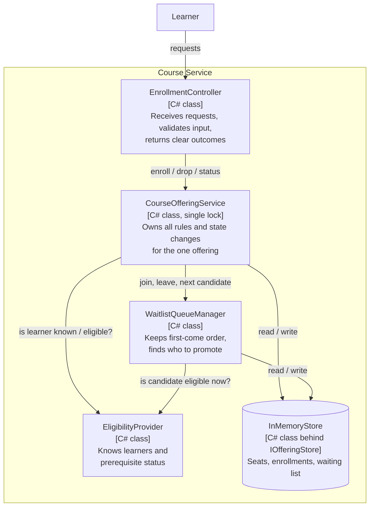
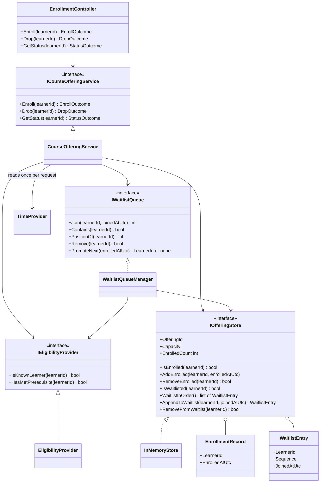
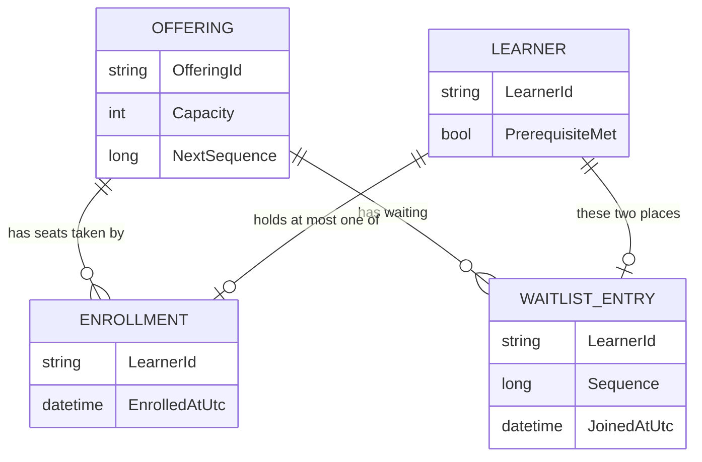

# C4 Architecture: Course Offering Enrollment and Waiting List

- Source requirements: [SRS v1.0 Frozen](../Requirements/SRS.md)
- Status: Gates 1 to 3 approved (HLD, LLD and flows, technology stack), data model finalized. Decisions: [ADR 0001](../adr/0001-waitlist-policy-and-concurrency.md), [ADR 0002](../adr/0002-technology-stack-selection.md).

## 1. Context View (C4 Level 1)

One actor and one system. The scope has no administrator, front end, identity integration, or database, so none appear here. Learner and prerequisite reference data is held inside the boundary (ASM-002).

## 2. Container / Component View (C4 Level 2/3)

### Component Responsibilities

| Component | Responsibility | Requirements |
|-----------|----------------|--------------|
| EnrollmentController | Single entry point; rejects blank identifiers; maps each result to a clear outcome; contains no rules | REQ-FUN-004, REQ-FUN-011, REQ-NFR-006 |
| CourseOfferingService | Enrollment, drop, and duplicate rules, capacity, and every state change; treats each request as one indivisible step | REQ-FUN-001 to REQ-FUN-003, REQ-FUN-005 to REQ-FUN-011, REQ-FUN-017 to REQ-FUN-020, REQ-NFR-001 to REQ-NFR-005, REQ-NFR-007 |
| WaitlistQueueManager | Joining order, positions, leaving the list, skip-and-retain scan for the next eligible learner | REQ-FUN-002, REQ-FUN-009, REQ-FUN-012 to REQ-FUN-016 |
| EligibilityProvider | Answers "is this learner known?" and "have they met the prerequisite right now?" | REQ-FUN-003, REQ-FUN-004, REQ-FUN-013 (POL-PRE-001) |
| InMemoryStore | Holds the offering, the enrolled learners, and the waiting list in order; implements `IOfferingStore` so another store can replace it later | REQ-NFR-004 |

### Key HLD Decisions
1. **One owner of state.** Only `CourseOfferingService` changes state, so the invariants live in one place (REQ-FUN-017, REQ-FUN-018).
2. **One request, one step.** A drop and its promotion complete as one unit so no other request sees a half-finished result (REQ-NFR-003). The mechanism is decided in ADR 0001.
3. **Eligibility is a separate, replaceable question.** Promotion re-checks the prerequisite at the moment it happens (REQ-FUN-013), so eligibility is never cached in the waiting list.
4. **The controller carries no rules.** It validates input and translates outcomes only.
5. **No new infrastructure.** Everything stays inside the one system, per the SRS out-of-scope list.

### Invariants
- The enrolled count never exceeds capacity (REQ-FUN-017, REQ-NFR-001).
- A learner is never both enrolled and waiting, and never appears twice in either (REQ-FUN-018).
- A rejected or failed request leaves all state unchanged (REQ-FUN-019, REQ-NFR-007).
- Waiting-list order is preserved across skips, repeats, and departures (REQ-FUN-016).

## 3. Low-Level Design

Sequence flows are in [sequence-flows.md](./sequence-flows.md). Known limitations are logged in [limitations.md](../limitations.md); LIM-001 is accepted, so the design follows the SRS literally.

### 3.1 Classes and Interfaces

### 3.2 Design Rules
- All dependencies are passed in from outside, so tests can substitute fake eligibility data.
- A waiting learner's position is calculated from the order of entries and never stored, so positions always run 1, 2, 3 with no gaps (REQ-NFR-004).
- The order key is a counter that only counts upward and is never reused, not a clock. A learner who drops and returns gets a later number (REQ-FUN-006). The same requests always give the same result (REQ-NFR-005).
- Timestamps are recorded for audit only. `CourseOfferingService` reads the time once per request, inside the lock, from an injected `TimeProvider`, and passes it to the store. No decision or ordering ever uses a timestamp, so results stay the same for the same requests (REQ-NFR-005).
- `WaitlistQueueManager` and `InMemoryStore` are not safe for simultaneous use on their own. They are reached only through `CourseOfferingService`, which makes each request one indivisible step (REQ-NFR-003). The mechanism is decided in ADR 0001.
- Capacity is validated when the offering is created; zero or a negative value is refused (REQ-FUN-020).
- Components depend on `IOfferingStore`, not on `InMemoryStore`. The next sequence number is kept inside the store and handed out by `AppendToWaitlist`, so it is never reused. Position is derived from `WaitlistInOrder()`.
- Concurrency (ADR 0001): `CourseOfferingService` holds one exclusive lock for the whole of every request, including status reads. Each request first reads and decides without changing anything, then applies all changes together, so a failure leaves no partial change (REQ-NFR-007).
- Business rejections are returned as explicit outcomes, not exceptions. Exceptions are reserved for unexpected failures, which leave no partial changes (REQ-NFR-007).

### 3.3 Outcome Catalogue (REQ-NFR-006)

| Operation | Outcome | Carries | Requirement |
|-----------|---------|---------|-------------|
| Enroll | `Enrolled` | none | REQ-FUN-001, REQ-FUN-006 |
| Enroll | `Waitlisted` | position | REQ-FUN-002, REQ-FUN-006 |
| Enroll | `AlreadyEnrolled` | none | REQ-FUN-005 |
| Enroll | `AlreadyWaitlisted` | position | REQ-FUN-005 |
| Enroll | `RejectedPrerequisiteNotMet` | none | REQ-FUN-003 |
| Enroll, Drop, Status | `RejectedUnknownLearner` | none | REQ-FUN-004, REQ-FUN-011 |
| Drop | `Dropped` | promoted learner, if any | REQ-FUN-008, REQ-FUN-012 |
| Drop | `RemovedFromWaitlist` | none | REQ-FUN-009 |
| Drop | `RejectedNotEnrolled` | none | REQ-FUN-010 |
| Status | `Enrolled`, `Waitlisted(position)`, `NotEnrolledOrWaitlisted` | position | REQ-FUN-007 |

### 3.4 Operation Logic
Each operation runs as one indivisible step.

**Enroll(learnerId)**
1. The controller rejects a blank identifier with `RejectedUnknownLearner`.
2. If the learner is unknown, return `RejectedUnknownLearner`.
3. If already enrolled, return `AlreadyEnrolled`. If already waiting, return `AlreadyWaitlisted(position)`.
4. If the prerequisite is not met, return `RejectedPrerequisiteNotMet`.
5. If the enrolled count is below capacity, enroll the learner. Otherwise add them to the end of the waiting list and return `Waitlisted(position)`.

The duplicate check precedes the prerequisite check, so an enrolled learner whose status later changed keeps their seat and gets `AlreadyEnrolled` (ASM-006).

**Drop(learnerId)**
1. If the learner is unknown, return `RejectedUnknownLearner`.
2. If enrolled, remove the enrollment, call `PromoteNext(now)`, and return `Dropped` naming the promoted learner if there is one.
3. If waiting, remove them from the list and return `RemovedFromWaitlist`; no seat opens and no one is promoted (ASM-008).
4. Otherwise return `RejectedNotEnrolled`.

**PromoteNext(now)** walks the waiting list in joining order and re-checks eligibility at that moment (REQ-FUN-013).
- An eligible learner is removed from the list, enrolled, and returned; at most one is promoted per freed seat (REQ-FUN-012).
- An ineligible learner is skipped and keeps their place (REQ-FUN-014).
- If nobody is eligible, the seat stays open and nothing changes (REQ-FUN-015).

**Enrolling into an open seat (LIM-001, accepted):** when a seat is open and a new eligible learner asks to enroll, they take it per REQ-FUN-001. No promotion pass runs first.

### 3.5 Data Model

There is no database (SRS out-of-scope). The data model is the in-memory structure behind `IOfferingStore` and `EligibilityProvider`.

| Entity | Fields | Owned by | Notes |
|--------|--------|----------|-------|
| Offering | `OfferingId` (string), `Capacity` (whole number greater than 0), `NextSequence` (whole number, starts at 1) | `IOfferingStore` | One offering exists (ASM-001). `NextSequence` only counts upward and is never reused. |
| Learner | `LearnerId` (case-sensitive string, not blank), `PrerequisiteMet` (yes/no) | `EligibilityProvider` | Reference data. "Known learner" means present here (ASM-002, ASM-003). |
| Enrollment | `LearnerId`, `EnrolledAtUtc` (UTC date and time) | `IOfferingStore` | Held as a dictionary keyed by learner ID. `EnrolledAtUtc` is when the learner got the seat, including by promotion. |
| Waiting-list entry | `LearnerId`, `Sequence` (whole number), `JoinedAtUtc` (UTC date and time) | `IOfferingStore` | Held as a list ordered by `Sequence` ascending. |

In memory these are a `Dictionary<string, EnrollmentRecord>` keyed by learner ID for enrollments and a `List<WaitlistEntry>` for the waiting list (ADR 0002).

**Calculated, not stored** (REQ-NFR-004):

| Value | How it is calculated |
|-------|----------------------|
| Enrolled count | Number of enrollments |
| Seats available | `Capacity` minus the enrolled count |
| Waiting-list position | Rank of the entry by `Sequence`, counting from 1 |

**Data rules**

| Rule | Enforced by | Requirement |
|------|-------------|-------------|
| Capacity is greater than 0 | Checked when the offering is created | REQ-FUN-020 |
| Enrolled count never exceeds capacity | Service checks before adding, inside the lock | REQ-FUN-017, REQ-NFR-001 |
| A learner holds at most one place, once | Service checks both groups first; the store also refuses a duplicate add as a second safeguard | REQ-FUN-018, POL-DUP-001 |
| Sequence numbers only increase and are never reused | Store assigns the number inside `AppendToWaitlist` | REQ-FUN-006, REQ-FUN-016 |
| Waiting list is ordered by sequence | Store returns entries ascending | REQ-FUN-016 |
| Timestamps never drive decisions or order; they are set once and not changed by repeated or rejected requests | Service passes one `now` per request; rejected requests write nothing | REQ-FUN-019, REQ-NFR-005 |
| A learner is eligible only if known and prerequisite met | `EligibilityProvider` | POL-PRE-001 |
| Learner IDs are exact, case-sensitive and not blank | Controller rejects blanks; lookups compare exactly | ASM-003 |

**Setup and lifetime**
- The console host sets the offering ID, the capacity and the known learners (with prerequisite status) in code at startup. There is no configuration file. Tests build their own data.
- `EligibilityProvider` exposes `AddLearner(id, prerequisiteMet)` and `SetPrerequisiteMet(id, value)` for the host and tests only; the SRS has no requirement for managing learners.
- Eligibility changes made outside a request are treated as a later event ([LIM-003](../limitations.md)).
- All data is lost on restart ([LIM-002](../limitations.md)).

**Mapping for a future real store (informational, not built):** a database-backed `IOfferingStore` should use one `placement` table so the one-place rule is enforced by the database.

| Table | Columns | Rules |
|-------|---------|-------|
| `offering` | `offering_id`, `capacity`, `next_sequence` | `capacity` > 0 |
| `learner` | `learner_id`, `prerequisite_met` | `learner_id` is the key |
| `placement` | `offering_id`, `learner_id`, `status` (enrolled or waitlisted), `sequence` (waitlisted only), `created_at_utc` | Unique on (`offering_id`, `learner_id`); `sequence` unique per offering and never reused |

A drop with its promotion would be one transaction, the database equivalent of the single lock.

## 4. Technology Stack

Decision record: [ADR 0002](../adr/0002-technology-stack-selection.md). Concurrency decision: [ADR 0001](../adr/0001-waitlist-policy-and-concurrency.md).

| Layer / Component | Technology | Version | Rationale |
|-------------------|------------|---------|-----------|
| Language and platform | C# on .NET | .NET 10 (`net10.0`), nullable reference types on | Matches the existing project in `Code/CourseRegistrationApplication` |
| Host | Console application | existing project | Thin host and composition root; no web framework (no API, front end, or deployment in scope) |
| EnrollmentController | Plain C# class | n/a | Application-facing entry class, not an MVC controller |
| CourseOfferingService | Plain C# class; `lock` on a private `System.Threading.Lock` | .NET 10 | One in-process lock around each whole request (ADR 0001); synchronous methods |
| WaitlistQueueManager | Plain C# class | n/a | Works only under the service's lock |
| EligibilityProvider | Plain C# class over a `ConcurrentDictionary` | .NET 10 | In-memory learner and prerequisite data; safe for simultaneous updates outside the offering lock |
| InMemoryStore | Plain C# class implementing `IOfferingStore`; `Dictionary<string, EnrollmentRecord>` and `List<WaitlistEntry>` | .NET 10 | In-memory only; no database (out of scope); replaceable via the interface |
| Clock | `System.TimeProvider` injected into `CourseOfferingService` | .NET 10 (built in) | Audit timestamps in UTC; tests supply a fake clock |
| Outcomes | Immutable `record` types | C# 14 | Explicit results instead of exceptions for business rejections |
| Testing | xUnit in a new test project in the same solution | latest stable, pinned at implementation | Runs with `dotnet test`; includes concurrency tests |
| Formatting and analysis | `.editorconfig`, `dotnet format`, built-in .NET analyzers | SDK built-in | Microsoft C# coding conventions |
| Build and packaging | `dotnet` CLI, existing `.slnx` solution | .NET 10 SDK | Already present |

Project layout (decided at implementation, one folder per component): `Controllers`, `Services`, `Waitlist`, `Eligibility`, `Storage`, `Outcomes`.
