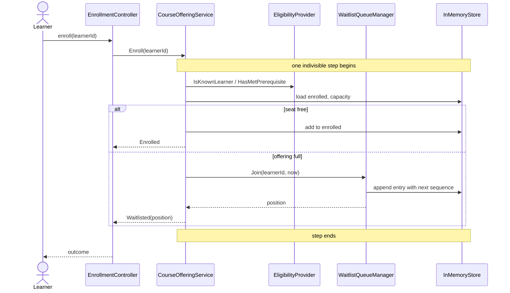
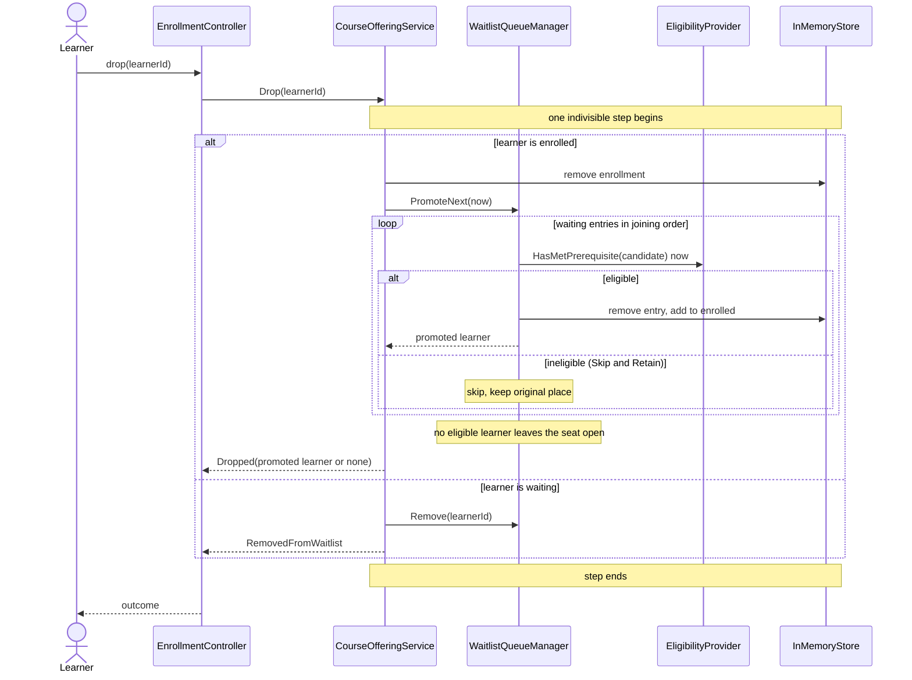
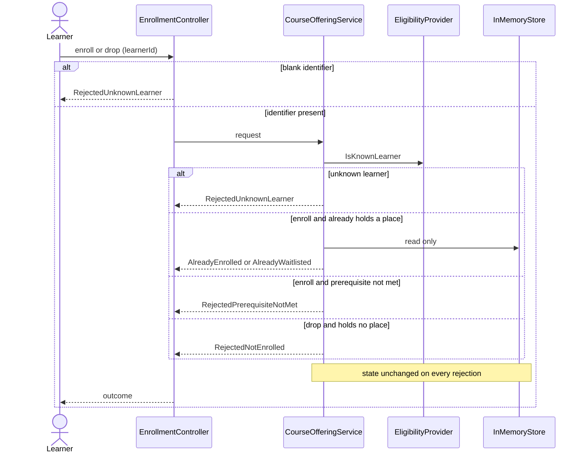

# Sequence Flows: Course Offering Enrollment and Waiting List

Participants match the components in [c4-architecture.md](./c4-architecture.md). The lock notes mark the one indivisible step per request (REQ-NFR-003); the mechanism is decided in ADR 0001.

## 1. Successful Enrollment and Full-Capacity Waiting-List Redirect
Covers: REQ-FUN-001, REQ-FUN-002, REQ-FUN-005, REQ-FUN-006, REQ-FUN-017, REQ-FUN-018

## 2. Learner Drop Triggering FIFO Waiting-List Promotion
Covers: REQ-FUN-008, REQ-FUN-009, REQ-FUN-012, REQ-FUN-013, REQ-FUN-014, REQ-FUN-015, REQ-FUN-016

## 3. Duplicate Requests and Error Guardrails
Covers: REQ-FUN-003, REQ-FUN-004, REQ-FUN-005, REQ-FUN-010, REQ-FUN-011, REQ-FUN-019, REQ-NFR-006, REQ-NFR-007

